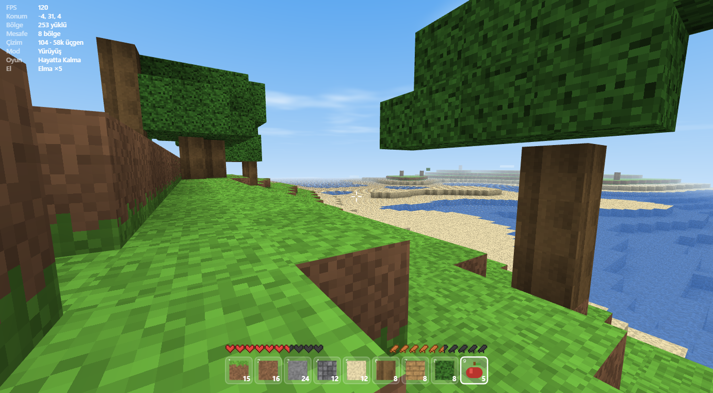
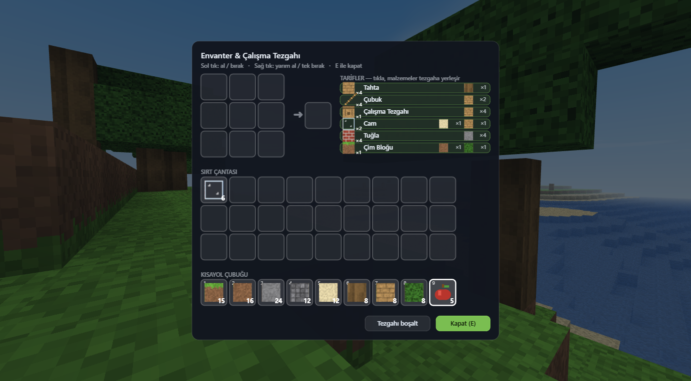
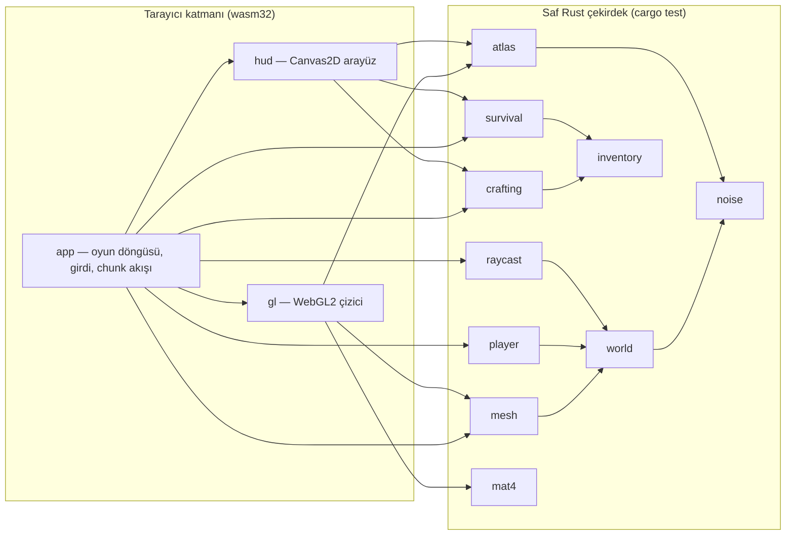

<div align="center">

# 🧱 VoxelCraft — Rust + WebAssembly

**Tarayıcıda çalışan, sonsuz ve prosedürel bir voxel dünyası.**
Sıfırdan Rust ile yazıldı · WebAssembly'ye derlenir · WebGL2 ile çizilir.

[](https://www.rust-lang.org/)
[](https://webassembly.org/)
[](https://www.khronos.org/webgl/)
[](https://github.com/rustwasm/wasm-bindgen)
[](#-doğrulama)
[](#-lisans)

[Özellikler](#-özellikler) •
[Hızlı Başlangıç](#-hızlı-başlangıç) •
[Kontroller](#-kontroller) •
[Oynanış](#-oynanış) •
[Mimari](#-mimari) •
[Doğrulama](#-doğrulama)



</div>

---

## 📖 Hakkında

VoxelCraft, orijinal tek dosyalık JavaScript oyununun **Rust** ile yeniden
yazılmış sürümüdür. WebAssembly'ye derlenir ve tarayıcıda **WebGL2** ile çalışır.

Three.js veya başka bir oyun motoru **kullanılmaz** — çizim, matematik, fizik ve
arayüz dâhil her şey Rust'ta yazıldı. Tek çalışma zamanı bağımlılığı tarayıcıyla
konuşmak için gereken `wasm-bindgen`, `js-sys` ve `web-sys` kütüphaneleridir.

## ✨ Özellikler

- 🌍 **Sonsuz dünya** — Perlin gürültüsüyle prosedürel arazi; chunk'lar talep
  üzerine üretilir ve bellekten boşaltılır.
- 💾 **Kalıcı düzenlemeler** — kırdığın/koyduğun bloklar uzaklaşıp döndüğünde
  korunur.
- 🎨 **Prosedürel dokular** — doku atlası çalışma anında RGBA tampona üretilir,
  hiçbir görsel dosya yüklenmez.
- 🌑 **Ambient occlusion** — yüz tabanlı mesh üretimi ve köşe gölgelendirmesi.
- ❤️ **Hayatta kalma modu** — can, açlık, nefes, düşme hasarı ve boğulma.
- 🕊️ **Yaratıcı mod** — uçuş, sınırsız blok, envanter yedekleme.
- 🛠️ **3×3 craft sistemi** — konumdan bağımsız şekilli ve şekilsiz tarifler.
- ⚡ **Yüksek performans** — görüş konisi (frustum) ayıklama, ~120 FPS.
- 📦 **Tek dosyalık sürüm** — çift tıklanarak açılan, sunucu gerektirmeyen HTML.
- ✅ **116 birim testi** + gerçek Chrome üzerinde başsız uçtan uca test.

## 🚀 Hızlı Başlangıç

> [!TIP]
> Windows için adım adım kurulum ve sık karşılaşılan hataların çözümleri
> **[KURULUM.md](KURULUM.md)** dosyasındadır.

### Gereksinimler

| Araç | Sürüm | Not |
|---|---|---|
| [Rust](https://rustup.rs/) | stable (2021 edition) | `rustup` ile kurulması önerilir |
| `wasm32-unknown-unknown` hedefi | — | `rustup target add` ile eklenir |
| [`wasm-bindgen-cli`](https://github.com/rustwasm/wasm-bindgen) | **0.2.129** | `Cargo.lock` içindeki kütüphane sürümüyle **birebir** eşleşmeli |
| Bash | — | `build.sh` için (Windows'ta Git Bash / WSL) |
| Node.js | isteğe bağlı | Tek dosya paketleyici ve başsız test için |

```bash
rustup target add wasm32-unknown-unknown
cargo install wasm-bindgen-cli --version 0.2.129   # veya hazır ikiliyi indirin
```

### Derleme ve çalıştırma

```bash
git clone https://github.com/TAHAFURKANTOSUN/fictional-palm-tree.git
cd fictional-palm-tree

./build.sh            # testleri çalıştırır, wasm'ı derler, pkg/ üretir
./build.sh serve 8080 # derler ve http://localhost:8080 üzerinde sunar
```

Ardından tarayıcıda **<http://localhost:8080>** adresini açın ve oyuna
tıklayarak fareyi kilitleyin.

> [!IMPORTANT]
> `index.html` dosyasını `file://` üzerinden açmak **çalışmaz**: `.wasm` dosyası
> `fetch` ile yüklenir ve tarayıcılar yerel dosyalarda CORS'a izin vermez.
> Bir HTTP sunucusu gerekir — ya da aşağıdaki tek dosyalık sürümü kullanın.

### 📦 Tek dosyalık sürüm

`./build.sh` ayrıca **`voxelcraft-rs.html`** üretir: JS bağlayıcısı satır içine
gömülür, wasm base64 olarak taşınır. Bu dosya **çift tıklanarak** açılabilir —
sunucu gerekmez. (Üretimi: [`tools/build_single_file.mjs`](tools/build_single_file.mjs).)

## 🎮 Kontroller

| Tuş | İşlev |
|---|---|
| <kbd>W</kbd> <kbd>A</kbd> <kbd>S</kbd> <kbd>D</kbd> | Hareket |
| Fare | Etrafa bak |
| Sol Tık | Blok kır |
| Sağ Tık | Blok koy / elma ye |
| <kbd>E</kbd> | Envanter & çalışma tezgahı |
| <kbd>F</kbd> veya <kbd>Space</kbd> ×2 | Uçuş (yalnızca Yaratıcı mod) |
| <kbd>G</kbd> | Yaratıcı ↔ Hayatta Kalma |
| <kbd>Space</kbd> / <kbd>Shift</kbd> | Zıpla / eğil (uçuşta yukarı / aşağı, suda yüz) |
| <kbd>Ctrl</kbd> | Koş / hızlı uç |
| <kbd>1</kbd>–<kbd>9</kbd>, fare tekerleği | Yuva seç |
| <kbd>[</kbd> <kbd>]</kbd> | Görüş mesafesi (3–16 bölge) |
| <kbd>H</kbd> | Arayüzü gizle |
| <kbd>Esc</kbd> | Fareyi bırak |

## 🌲 Oynanış

- **Sonsuz dünya** — yalnızca çevrendeki chunk'lar bellekte tutulur; gerisi
  talep üzerine üretilir ve boşaltılır. Kırdığın/koyduğun bloklar `chunkEdits`
  sayesinde uzaklaşıp döndüğünde korunur.
- **Hayatta kalma** — 20 can (10 kalp) + 20 açlık (10 but). Koşma, zıplama,
  yüzme ve blok kırma yorgunluk üretir; yorgunluk açlığa dönüşür. Açlık 0 olunca
  yıldız açlığı başlar; tokken can yenilenir. 3 bloktan yüksek düşüşler hasar
  verir, su altında 15 saniye sonra boğulmaya başlarsın.
- **Yüzme** — suda yerçekimi yerine yumuşak batma işler; <kbd>Space</kbd> ile
  yukarı yüzüp yüzeye çıkabilirsin. Yatay hız suda düşer (koşarken 4,0 / normal
  2,6 blok/sn). Böylece okyanusa düşünce dibe çakılıp boğulmazsın.
- **Yemek** — yapraklar %14 olasılıkla 🍎 **elma** düşürür; sağ tıkla ye
  (+6 açlık).
- **Yaratıcı mod** (<kbd>G</kbd>) — can/açlık devre dışı, uçuş açık, envanter
  13 çeşit bloğun 64'lük paletiyle dolar, koymak hiçbir şey harcamaz. Hayatta
  kalmaya dönünce önceki envanterin aynen geri gelir.

### 🛠️ Craft tarifleri



| Girdi | Çıktı |
|---|---|
| 1 Kütük | 4 Tahta |
| 2 Tahta (dikey) | 4 Çubuk |
| 4 Tahta (2×2) | Çalışma Tezgahı |
| Kum + Tahta | 2 Cam |
| 4 Taş (2×2) | 4 Tuğla |
| Toprak + Yaprak | Çim Bloğu |

Şekilli tarifler **konumdan bağımsızdır**: malzemeyi ızgaranın neresine
koyarsan koy, dolu hücrelerin sınırlayıcı kutusu desenle karşılaştırılır.

<br clear="right">

## 🏗️ Mimari

Motor bilerek iki katmana ayrıldı:

| Katman | Modüller | Özellik |
|---|---|---|
| **Saf çekirdek** | `noise`, `world`, `blocks`, `mesh`, `atlas`, `raycast`, `player`, `inventory`, `crafting`, `survival`, `mat4` | Hiçbir tarayıcı API'si kullanmaz → `cargo test` ile doğrulanabilir |
| **Tarayıcı katmanı** | `app`, `gl`, `hud` | Yalnızca `wasm32` hedefinde derlenir (`#[cfg(target_arch = "wasm32")]`) |

Bu ayrım sayesinde oyunun **tüm kuralları** (arazi sürekliliği, mesh üretimi,
çarpışma, craft eşleştirme, açlık/can matematiği) tarayıcı açmadan test edilir.



### 📁 Proje yapısı

```text
voxelcraft-rs/
├── Cargo.toml            # bağımlılıklar (yalnızca wasm-bindgen + web-sys)
├── build.sh              # derleme + test + JS bağlayıcı üretimi
├── index.html            # tarayıcı kabuğu (iki canvas + kaplamalar)
├── KURULUM.md            # Windows için ayrıntılı kurulum rehberi
├── docs/screenshots/     # README görselleri
├── src/
│   ├── lib.rs            # modül ağacı ve wasm dışa aktarımları
│   ├── blocks.rs         # blok/eşya kimlikleri ve doku eşlemeleri
│   ├── noise.rs          # Perlin gürültüsü + hash fonksiyonları
│   ├── world.rs          # sonsuz chunk deposu, arazi üretimi, oyuncu düzenlemeleri
│   ├── mesh.rs           # yüz mesh'i + ambient occlusion
│   ├── atlas.rs          # prosedürel doku atlası (RGBA tampon)
│   ├── raycast.rs        # DDA voxel ışın izleme
│   ├── player.rs         # hareket, AABB çarpışması, uçuş
│   ├── inventory.rs      # 36 yuvalı envanter
│   ├── crafting.rs       # 3×3 şekilli/şekilsiz tarifler
│   ├── survival.rs       # can, açlık, nefes, hasar, oyun modu
│   ├── mat4.rs           # 4×4 matrisler + görüş konisi (frustum)
│   ├── gl.rs             # WebGL2 çizici (gölgelendiriciler, VAO/VBO)
│   ├── hud.rs            # Canvas2D arayüzü (kalpler, çubuk, envanter ekranı)
│   └── app.rs            # oyun döngüsü, girdi, chunk akışı
└── tools/
    ├── smoke.sh               # güvenli başsız Chrome testi (kurulum+test+temizlik)
    ├── headless_test.mjs      # CDP üzerinden oyun kurallarını süren test
    └── build_single_file.mjs  # tek dosyalık HTML paketleyici
```

## ✅ Doğrulama

### Birim testleri

```bash
cargo test --lib          # 118 test
```

<details>
<summary><b>Test kapsamını göster</b></summary>

<br>

- Gürültü sürekliliği ve aralığı
- Yükseklik fonksiyonunun chunk sınırında sıçramaması
- Üretimin sırasız ve deterministik olması
- Oyuncu düzenlemelerinin kalıcılığı
- ±1.000.000 blok uzakta arazi üretimi
- Mesh öznitelik dengesi, indeks sınırları, daraltılmış y aralığı, kapsayıcı küre
- Mesh'in chunk'taki **en yüksek bloğu** (ağaç tepeleri) kapsaması
- Köşe AO'sunun **çapraz komşu chunk'a** bağlı olması
- Atlas döşemeleri
- DDA ışın izleme (normal yönü dâhil)
- AABB çarpışması ve tünelleme engeli
- Yığınlama (stacking)
- Craft eşleştirme (offset, fazla malzeme, zincir üretim)
- Açlık / can / yorgunluk / boğulma / düşme matematiği
- Mod geçişinde envanterin korunması

</details>

### Başsız tarayıcı testi

[`tools/headless_test.mjs`](tools/headless_test.mjs) gerçek Chrome'da
**0 konsol hatası** ve **0 yakalanmamış Promise hatası** olduğunu doğrular ve
oyunu Chrome DevTools Protocol üzerinden sürer:

<details>
<summary><b>Doğrulanan davranışları göster</b></summary>

<br>

- Dünya kurulumu ve başlangıç kiti
- Hasar alma, 20 sn yıldız açlığı, tokken iyileşme
- Yaratıcı modda hasar olmaması ve koymanın blok harcamaması
- Hayatta kalmaya dönüşte envanterin geri gelmesi
- Koyma tüketimi ve yemek yeme
- Hayatta kalma modunda uçuşun engellenmesi
- Pencere yeniden boyutlandığında HUD'un ve en-boy oranının güncellenmesi
- Okyanusta <kbd>Space</kbd> ile yüzeye çıkabilme ve batma hızının sınırlı olması
- ~120 FPS
- (50000, −50000) noktasına ışınlanmada bellek sınırının korunması

</details>

Önerilen çalıştırma yolu:

```bash
./build.sh          # wasm + pkg/ üret
./tools/smoke.sh    # sunucu + başsız Chrome + test + temizlik (tek adım)
```

> [!WARNING]
> **Chrome'u `taskkill /F /IM chrome.exe` ile kapatmayın.** `/IM` görüntü adına
> göre eşleştiği için açık olan tüm Chrome pencerelerinizi de zorla kapatır.
> `tools/smoke.sh` yalnızca kendi başlattığı Chrome süreç ağacını (CDP portunu
> dinleyen PID) ve kendi HTTP sunucusunu kapatır; profil olarak da geçici bir
> `--user-data-dir` kullanır, gerçek profilinize dokunmaz.

## 🤝 Katkıda Bulunma

Katkılar memnuniyetle karşılanır! Bir değişiklik göndermeden önce:

1. Depoyu fork'layın ve bir dal oluşturun: `git checkout -b ozellik/yeni-blok`
2. Oyun kuralı değişikliklerini mümkünse **saf çekirdek** katmanında yapın ve
   birim testi ekleyin.
3. `cargo test --lib` ve `./tools/smoke.sh` komutlarının geçtiğinden emin olun.
4. Açıklayıcı bir commit mesajıyla Pull Request açın.

## 📄 Lisans

Bu proje [`Cargo.toml`](Cargo.toml) dosyasında belirtildiği üzere **MIT**
lisansı ile dağıtılmaktadır.

<div align="center">

---

Rust 🦀 ve WebAssembly ile ❤️ kullanılarak yapıldı.

</div>