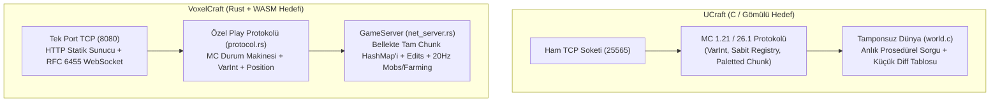

# UCraft (`vimpop/UCraft`) Sunucu Sistemi İncelemesi ve VoxelCraft'a Uygulanabilirlik Raporu

> **İncelenen Kaynak:** [github.com/vimpop/UCraft](https://github.com/vimpop/UCraft)  
> **Hedef Proje:** `voxelcraft-rs` ([`src/net_server.rs`](../src/net_server.rs), [`src/protocol.rs`](../src/protocol.rs), [`src/world.rs`](../src/world.rs), [`src/bin/server.rs`](../src/bin/server.rs))  
> **Tarih:** 15 Kasım 2026

---

## 1. Yönetici Özeti

**UCraft (`vimpop/UCraft`)**, aşırı kısıtlı donanımlarda (mikrodenetleyiciler, IoT kartları, yönlendiriciler ve gömülü RTOS ortamları) çalışmak üzere tamamen **C** dilinde sıfırdan yazılmış ultra-hafif bir Minecraft sunucu gerçeklemesidir. Şifrelemesiz derlendiğinde **~46 KB** (`mbedTLS` ile ~70 KB) ikili (binary) boyuta sahiptir ve bağlı tek bir oyuncu için ortalama **~50 KB RAM** tüketir.

**VoxelCraft (`voxelcraft-rs`)** ise halihazırda [`src/protocol.rs`](../src/protocol.rs) ve [`src/net_server.rs`](../src/net_server.rs) modüllerinde harici kütüphane kullanmayan (`std::net` tabanlı), **HTTP + RFC 6455 WebSocket** üzerinden çalışan ve Minecraft: Java Edition protokol durum makinesini (`Handshaking → Status / Login → Configuration → Play`) temel alan bir çok oyunculu sunucuya sahiptir.

İki sistem karşılaştırıldığında mimari felsefelerinin (**sıfır şişkinlik, deterministik prosedürel dünya, minimal protokol alt kümesi**) büyük ölçüde örtüştüğü; ancak **UCraft'ın bellek koruma ve durum senkronizasyonu tekniklerinin** VoxelCraft sunucusundaki mevcut ölçeklenebilirlik darboğazlarını (özellikle sunucu belleğinde chunk'ların hiç boşaltılmaması ve tüm dünya düzenlemelerinin tekil paketlerle gönderilmesi) çözmek için **doğrudan uygulanabilir** olduğu görülmektedir.

---

## 2. UCraft (`vimpop/UCraft`) Sunucu Sisteminin Teknik İncelemesi

### 2.1. Mimari Felsefe ve Kaynak Profili
UCraft, tam kapsamlı bir Vanilla/Paper sunucusunun yerini almak için değil; bir istemcinin bağlanıp prosedürel dünyada gezinebilmesi, blok kırıp koyabilmesi, sohbet edebilmesi ve temel envanter/craft işlemlerini yapabilmesi için gereken **en küçük geçerli protokol kümesini (bare-essentials)** sağlamak üzere tasarlanmıştır.

| Metrik | UCraft (`vimpop/UCraft`) Değeri |
|---|---|
| **Dil ve Yapı Sistemi** | C (C99/C11), CMake + CTest |
| **İkili Dosya Boyutu (Binary)** | ~46 KB (çevrimdışı mod) / ~70 KB (`mbedTLS` ile çevrimiçi mod) |
| **Çalışma Zamanı Bellek (RAM)** | ~50 KB (tek oyunculu oturumda ortalama) |
| **Hedef İstemci Protokolü** | Modern Minecraft: Java Edition (1.21.x / 26.1.x protokol uyumlu) |
| **Harici Bağımlılıklar** | Yalnızca opsiyonel `mbedTLS` (kriptografik oturum açma için) |
| **Türev Gömülü Portlar** | `UCraft-bl602` (RISC-V IoT Wi-Fi çipi), `UCraft-printer` (gömülü yazıcı RTOS görevi) |

### 2.2. Ağ ve Protokol Katmanı
1. **Olay Döngüsü ve Soket Yönetimi:** Standart POSIX/Winsock TCP soketleri üzerinde bloklamayan (non-blocking) tek iş parçacıklı (single-threaded) yoklama yapısıyla çalışır. Sabit boyutlu küçük okuma/yazma tamponları kullanarak dinamik bellek ayırmalarını (`malloc`/`free`) en aza indirir.
2. **Durum Makinesi (State Machine):** Minecraft protokolünün standart aşamalarını (`Handshake`, `Status`, `Login`, `Configuration`, `Play`) uygular:
   * **Status (Server List Ping):** Sunucu listesi için JSON durum yanıtı ve `Ping`/`Pong` paketlerini işler.
   * **Login & Şifreleme:** Çevrimdışı (offline) modda doğrudan UUID/isim ile geçiş yapar; çevrimiçi (online) mod etkinse `mbedTLS` üzerinden RSA/AES el sıkışmasını tamamlar.
   * **Configuration & Sabit Kayıt Defteri (Registry):** Modern Minecraft istemcilerinin `Configuration` aşamasında zorunlu tuttuğu biyom/boyut kayıt defteri (registry) verilerini çalışma zamanında dinamik NBT ağacı oluşturmak yerine önceden hazırlanmış **sabit bayt dizileri (static blobs)** olarak gönderir.
3. **Play Paketleri:** Yalnızca oyuncu konumu/rotasyonu, blok kırma/yerleştirme, temel envanter/craft etkileşimleri, sohbet ve `KeepAlive` paketlerini ayrıştırır; desteklenmeyen veya gereksiz paketleri sessizce tüketir.

### 2.3. Dünya Üretimi ve ~50 KB RAM Sırrı (`world.c`)
Standart bir Minecraft sunucusu her chunk (`16×384×16`) için onlarca kilobaytlık blok, ışık ve biyom dizisini RAM'de tutar. UCraft'ın 50 KB RAM sınırında kalmasını sağlayan temel tasarım kararları şunlardır:

1. **Tam Chunk Tamponu Tutmayan Anlık Sorgu (`worldGetBlock`):**
   * UCraft, dünyadaki tüm chunk'ları bellekte açık 3B diziler halinde **saklamaz**.
   * Bir koordinattaki `(x, y, z)` bloğu sorgulandığında (`worldGetBlock`), önce oyuncunun yaptığı değişiklikleri tutan küçük fark (diff/edit) tablosuna bakar.
   * Koordinat değiştirilmemişse, bloğun ne olduğunu (taş, toprak, çimen, ağaç vb.) o anda **deterministik prosedürel fonksiyonla** hesaplar.
2. **İstemciye Anlık Üretip Gönderme (On-the-Fly Chunk Streaming):**
   * İstemci yeni bir chunk'a yaklaştığında, chunk verisi prosedürel fonksiyondan + değişiklik tablosundan anlık olarak üretilir, ağ paketine serileştirilir, TCP soketine yazılır ve tampon hemen yeniden kullanılır.
3. **Daraltılmış Kesitler (Shifted/Compact Chunk Sections):**
   * Dünya yüksekliğinin tamamı için boş hava/taş katmanları ayırmak yerine yalnızca aktif arazi kesitleri (section) kaydırılarak işlenir; paletli (paletted) blok kodlamasıyla ağ ve bellek boyutu küçültülür.

### 2.4. Test ve Doğrulama Altyapısı
* **Birim ve Regresyon Testleri (`CTest`):** Kaydedilmiş gerçek paket dizileri (recorded fixtures) üzerinden protokol ayrıştırıcısını ve dünya mantığını gerçek bir ağ bağlantısı olmadan sınar.
* **TCP Duman Testleri (Python):** Mojang hesabına ihtiyaç duymadan çoklu istemci bağlantısını, `Status` pinglerini ve **bozuk/eksik çerçeve (malformed frame) kurtarma** senaryolarını test eder.

---

## 3. VoxelCraft Mevcut Sunucu Sistemi ile Karşılaştırma

VoxelCraft projesinde [`src/net_server.rs`](../src/net_server.rs) ve [`src/protocol.rs`](../src/protocol.rs) içinde zaten çalışan bir çok oyunculu sunucu bulunmaktadır. İki sistemin mimari karşılaştırması aşağıdadır:

| Özellik / Katman | `vimpop/UCraft` | `voxelcraft-rs` (`net_server.rs` + `protocol.rs`) | Değerlendirme |
|---|---|---|---|
| **Dil & Güvenlik** | C (manuel bellek yönetimi) | Rust (bellek güvenli, sıfır `unsafe`) | VoxelCraft bellek güvenliği açısından üstün. |
| **Harici Bağımlılık** | Yok (opsiyonel `mbedTLS`) | **Yok** (saf `std::net`, dahili SHA-1/Base64) | İki proje de sıfır bağımlılık felsefesini paylaşıyor. |
| **Taşıma Katmanı** | Ham TCP | **HTTP + WebSocket** (aynı portta birleşik) | Tarayıcı (`wasm32`) ham TCP açamadığı için VoxelCraft'ın WebSocket seçimi zorunlu ve doğru. |
| **Bağlantı Durumları** | `Handshake → Status/Login → Config → Play` | `Handshake → Status/Login → Config → Play` ([`protocol.rs:434`](../src/protocol.rs#L434-L440)) | Birebir aynı durum makinesi. |
| **Temel Veri Tipleri** | `VarInt`, `Position` (64-bit), `Angle` | `VarInt`, `Position` (64-bit), `Angle` ([`protocol.rs:253`](../src/protocol.rs#L253-L334)) | Birebir aynı bit paketleme düzeni. |
| **Dünya Senkronizasyonu** | Sunucu chunk'ı anlık üretip gönderir | Sunucu **yalnızca `seed` + `edits`** gönderir; istemci kendi chunk'ını üretir ([`net_server.rs:587`](../src/net_server.rs#L587-L604)) | VoxelCraft ağ bant genişliğinde çok daha tasarruflu (chunk verisi ağdan taşınmaz). |
| **Sunucu RAM'inde Dünya** | Tam chunk tutulmaz; `worldGetBlock` anlık hesaplar (~50 KB RAM) | `World::chunks` içinde her chunk `16×16×64 = 16 KB` `Vec<u8>` olarak tutulur ve **sunucuda hiç boşaltılmaz** ([`net_server.rs:864`](../src/net_server.rs#L864)) | **UCraft burada çok daha verimli.** VoxelCraft sunucusunda oyuncular gezdikçe RAM sınırsız büyür. |
| **Canlılar (Mobs) & Tarım** | Yok (yalnızca oyuncu ve bloklar) | 20 Hz sunucu simülasyonu (`Mobs::tick_multi`, `Farming::tick`) | VoxelCraft oynanış açısından daha zengin. |

---

## 4. VoxelCraft'a Uygulanabilirlik Analizi

### 4.1. Doğrudan Uygulanabilir İyileştirmeler (Yüksek Öncelik)

#### 1. Sunucu Tarafında "Tamponsuz Dünya Sorgusu" (UCraft `worldGetBlock` Modeli) ve Chunk Tahliyesi
* **Mevcut Durum (Sorun):** [`src/net_server.rs:859-867`](../src/net_server.rs#L859-L867) satırlarında her tick'te oyuncuların etrafındaki 5×5 chunk için `self.world.ensure_chunk(...)` çağrılmaktadır. Ayrıca oyuncu hareket ettikçe [`net_server.rs:674`](../src/net_server.rs#L674) üzerinde `ensure_around` çağrılır. Ancak sunucu tarafında **`unload_chunk` hiçbir zaman çağrılmamaktadır**. Her üretilen chunk bellekte `16.384 bayt` (`data: Vec<u8>`) + bitki önbelleği tutar. Oyuncular dünyada uzaklara yürüdükçe sunucu belleği sürekli şişer. Ayrıca blok değişiklikleri hem `GameServer::edits` (`HashMap<(i32,i32,i32), u8>`) hem de `World::edits` (`HashMap<u64, HashMap<usize, u8>>`) içinde **çift kopya** olarak tutulmaktadır.
* **UCraft Çözümünün Uygulanması:**
  1. **Kısa Vadeli Çözüm (Aktif Chunk Tahliyesi):** Sunucuda her `step_world` adımında aktif oyuncuların `[-3..=3]` chunk yarıçapı dışında kalan tüm chunk'lar `self.world.chunks.retain(...)` ile bellekten atılmalıdır. Böylece UCraft gibi oyuncu başına sabit ve çok düşük bir RAM tavanı (~400 KB/oyuncu) garanti edilir.
  2. **Orta Vadeli Çözüm (Tamponsuz `get_block_procedural`):** Sunucu GPU mesh'lemesi yapmadığı için (`meshed`, `min_open`, `content_top` alanları sunucuda hiç kullanılmaz), sunucu tarafında `Chunk` tahsis etmek yerine UCraft'ın `worldGetBlock` yaklaşımıyla önce `edits` haritasına bakan, yoksa `height_at(x, z)` üzerinden bloğu anlık döndüren hafif bir sorgu metodu kullanılabilir.

#### 2. Bölgesel Değişiklik Senkronizasyonu (Chunk-Scoped Edit Sync)
* **Mevcut Durum (Sorun):** [`src/net_server.rs:593-604`](../src/net_server.rs#L593-L604) içinde yeni bir oyuncu `Play` durumuna geçtiğinde, sunucu açıldığından beri dünyada yapılmış **tüm** blok değişikliklerini (`self.edits`) tek tek `Packet::BlockUpdate` çerçevesi olarak gönderir. Dünyada 50.000 blok değiştirilmişse yeni giren oyuncuya anında 50.000 ayrı WebSocket çerçevesi basılır.
* **UCraft Çözümünün Uygulanması:**
  * Değişiklikler `HashMap<u64, HashMap<u16, u8>>` (chunk anahtarı → chunk içi 14-bit yerel indeks `0..16384` → blok kimliği) olarak saklanmalıdır (bu yapı zaten [`World::edits`](../src/world.rs#L66) içinde mevcuttur, `GameServer::edits` tekrarı kaldırılabilir).
  * Protokole tek bir **`ChunkEdits { cx: i32, cz: i32, edits: Vec<(u16, u8)> }`** paketi eklenerek veya oyuncunun yalnızca görüş mesafesindeki (`render_dist`) chunk'ların değişiklikleri gönderilerek bağlantı anındaki ağ trafiği %95+ azaltılabilir.

#### 3. İlgi Alanı Yönetimi (Spatial Interest Management / Görüş Mesafesi Filtresi)
* **Mevcut Durum (Sorun):** [`src/net_server.rs:975`](../src/net_server.rs#L975) içindeki `broadcast_play` fonksiyonu, bir oyuncu `(1_000_000, 1_000_000)` koordinatında blok kırdığında veya hareket ettiğinde bunu `(0, 0)` noktasındaki oyuncuya da yayınlar.
* **UCraft Çözümünün Uygulanması:**
  * UCraft'ın oyuncu başına aktif chunk penceresi yaklaşımıyla, `MoveEntity`, `SpawnEntity` ve `BlockUpdate` yayınları yalnızca hedef oyuncuya belirli bir mesafe (ör. `16 chunk = 256 blok`) içindeyse gönderilmelidir.

#### 4. Sabit Boyutlu Okuma Tamponu ve DoS Koruması
* **Mevcut Durum (Sorun):** [`src/net_server.rs:441`](../src/net_server.rs#L441) satırında istemciden gelen TCP verisi `client.raw_in.extend_from_slice(&buf[..n])` ile sınırsız büyüyebilen bir `Vec<u8>` içine eklenmektedir. Kötü niyetli veya bozuk bir istemci eksik bir WebSocket çerçevesi göndererek sunucu belleğini şişirebilir.
* **UCraft Çözümünün Uygulanması:**
  * UCraft'ta olduğu gibi istemci başına `raw_in` ve `decoder.buf` için sıkı bir üst sınır (ör. `64 KB`) konulmalı; sınırı aşan veya bozuk çerçeve gönderen istemci bağlantısı derhal kapatılmalıdır.

#### 5. Kaydedilmiş Paket Fikstürleri ve Parçalı/Bozuk Çerçeve Testleri
* **Mevcut Durum:** [`src/net_server.rs:1164`](../src/net_server.rs#L1164) içinde tam akış testi mevcuttur, ancak TCP parçalanması (1 baytlık parçalar halinde gelen WebSocket çerçeveleri) ve bozuk çerçeve kurtarma testleri eksiktir.
* **UCraft Çözümünün Uygulanması:** UCraft'ın test süitindeki gibi kısmi (fragmented) TCP/WebSocket çerçevelerini ve bozuk protokol verilerini sınayan birim testleri [`src/net_server.rs`](../src/net_server.rs) içine eklenebilir.

---

### 4.2. Uygulanması Önerilmeyen veya Kapsam Dışı Özellikler

| UCraft Özelliği | Neden VoxelCraft İçin Uygun / Gerekli Değil? |
|---|---|
| **C Diline Geçiş** | VoxelCraft'ın en büyük gücü, `world`, `farming`, `mobs` ve `protocol` modüllerinin hem tarayıcıda (`wasm32`) hem sunucuda (`native`) **aynı Rust kodunu** paylaşmasıdır. C'ye geçmek bu kod paylaşımını bozar. |
| **`mbedTLS` ve Mojang Oturum Doğrulaması** | VoxelCraft tarayıcı tabanlı bağımsız bir oyundur; Mojang hesap sunucularıyla (`sessionserver.mojang.com`) konuşmasına gerek yoktur. Şifreleme gerekiyorsa sunucu önüne standart TLS/HTTPS ters vekili (Caddy/Nginx) koymak `wss://` için yeterlidir. |
| **Tam Chunk Verisini Ağdan Göndermek** | Resmi Minecraft istemcisi sunucudan tam chunk verisi (`Chunk Data and Update Light`) bekler; bu yüzden UCraft chunk'ları ağdan göndermek zorundadır. VoxelCraft istemcisi ise aynı `World::generate_chunk` koduna sahip olduğu için sunucunun yalnızca `seed` + `edits` göndermesi çok daha üstün bir mimaridir. |

---

## 5. Önerilen Uygulama Yol Haritası

UCraft incelemesinden elde edilen bulguların [`src/net_server.rs`](../src/net_server.rs) ve [`src/protocol.rs`](../src/protocol.rs) üzerine uygulanması için önerilen 3 aşamalı plan:

1. **Aşama 1 — Sunucu Bellek Tavanı (UCraft Bellek Disiplini):**
   * `GameServer::edits` tekrarını kaldırıp `World::edits` ile birleştirmek.
   * `GameServer::step_world` sonunda aktif oyuncuların çevresinde olmayan chunk'ları `World::unload_chunk` ile tahliye ederek sunucu RAM kullanımını sabitlemek.
   * `ClientPeer::raw_in` tamponuna üst sınır (`MAX_CLIENT_BUF`) eklemek.
2. **Aşama 2 — Ağ Trafiği Optimizasyonu:**
   * Tekil `BlockUpdate` başlangıç yağmuru yerine toplu/bölgesel değişiklik senkronizasyonu eklemek.
   * `broadcast_play` içine mesafe filtresi (` broadcast_near`) eklemek.
3. **Aşama 3 — Bozuk Çerçeve ve Parçalanma (Fragmentation) Testleri:**
   * UCraft test yaklaşımına paralel olarak `net_server::tests` altına parçalı WebSocket çerçevesi ve aşırı büyük tampon koruma testleri eklemek.

---

## 6. ESP32-C6 ve ESP32-P4 Üzerinde Kapasite Analizi

Belgedeki UCraft tarzı bellek ve ağ iyileştirmeleri (tamponsuz prosedürel blok sorgusu `worldGetBlock`, sabit `4 KB` istemci tamponları, bölgesel ilgi alanı filtresi ve statik dosyaların RAM yerine Flash/gzip üzerinden akıtılması) uygulandıktan sonra **ESP32-C6** ve **ESP32-P4** donanımlarında elde edilecek gerçekçi oyuncu kapasiteleri aşağıdadır.

### 6.1. Donanım Kısıtları ve Oyuncu Başına Maliyet (İyileştirme Sonrası)

* **Oyuncu Başına Bellek (RAM) Tüketimi:**
  * Tamponsuz dünya (`worldGetBlock` + ortak `edits` tablosu) ile oyuncu başına chunk dizisi (`16 KB`) ayrılmaz.
  * `ClientPeer` yapısı + `4 KB` giriş / `4 KB` çıkış tamponu + lwIP TCP PCB ve soket tamponları ≈ **12–16 KB RAM / oyuncu**.
* **20 Hz Tick Başına İşlemci (CPU) Yükü (`50 ms` bütçe):**
  * WebSocket çerçeve çözme + `PlayerPosition` / `MoveEntity` yayını + Perlin gürültüsü (`f64` / `f32`) ve `Mobs` çarpışma fiziği.

### 6.2. Senaryo 1: Tek Başına ESP32-C6
* **Donanım:** Tek çekirdek 160 MHz 32-bit RISC-V (**FPU yok** — `f32`/`f64` yazılımsal emülasyonla çalışır), 512 KB SRAM (Wi-Fi + BLE + ESP-IDF/lwIP yığını sonrası uygulamaya **~180–220 KB boş SRAM** kalır), 802.11ax (Wi-Fi 6).
* **Darboğazlar:**
  1. **lwIP Maksimum Soket Sınırı (`CONFIG_LWIP_MAX_SOCKETS`):** ESP-IDF'de varsayılan 10–16'dır; Wi-Fi tamponlarıyla birlikte güvenli TCP soket tavanı düşüktür.
  2. **Donanımsal FPU Eksikliği:** [`src/noise.rs`](../src/noise.rs) ve [`src/mobs.rs`](../src/mobs.rs) içindeki `f64` hesaplamaları yazılımla (soft-float) yapılır.
* **Kapasite (İyileştirme Sonrası):**
  * **Tam Simülasyon (Mobs + Tarım açık, `f32` dönüşümüyle):** **4 – 6 Eşzamanlı Oyuncu** (20 TPS sabit).
  * **Saf UCraft Modu (Mobs kapalı, yalnızca yürüyüş + blok kırma/koyma + sohbet):** **8 – 10 Eşzamanlı Oyuncu** (~150 KB RAM kullanımıyla).

### 6.3. Senaryo 2: ESP32-P4 (+ Ağ Yardımcı İşlemcisi Olarak ESP32-C6)
> **Not:** ESP32-P4 üzerinde dahili Wi-Fi radyosu yoktur; genellikle Ethernet (RMII) veya SDIO/SPI üzerinden **ESP32-C6 (`esp-hosted`)** Wi-Fi 6 yardımcı çipi ile birlikte kullanılır.

* **Donanım:** Çift çekirdek **400 MHz** 32-bit RISC-V HP çekirdeği (**Donanımsal FPU mevcut**), **768 KB dahili HP L2MEM SRAM** + **16 MB / 32 MB harici Hexa/Octal PSRAM**.
* **Avantajlar:**
  * 400 MHz çift çekirdek + FPU sayesinde Perlin gürültüsü ve 20 Hz varlık fiziği ESP32-C6'ya göre **~8–12 kat daha hızlı** çalışır.
  * bir çekirdek ağ/HTTP/WebSocket G/Ç işlemlerine, diğer çekirdek `GameServer::tick` (20 Hz dünya ve mob simülasyonu) döngüsüne ayrılabilir.
* **Kapasite (İyileştirme Sonrası):**
  * **Yalnızca Dahili SRAM (768 KB, PSRAM'siz):**
    * **Tam Simülasyon (Mobs + Tarım açık):** **16 – 24 Eşzamanlı Oyuncu**.
    * **Saf UCraft Modu (Mobs kapalı):** **32 – 40 Eşzamanlı Oyuncu** (bu noktada sınır RAM veya CPU değil, ESP32-C6 SDIO/SPI köprüsünün saniyede geçirebildiği küçük TCP paket sayısı / Wi-Fi airtime olur).
  * **Harici PSRAM (16 MB / 32 MB) + Ethernet veya Yüksek Hızlı SDIO ile:**
    * Bellek sınırı tamamen kalkar (binlerce chunk ve on binlerce blok değişikliği PSRAM'de tutulabilir).
    * **Tam Simülasyon (20 Hz Mobs + Tarım):** **32 – 50 Eşzamanlı Oyuncu** (`MAX_PLAYERS = 32` sınırı rahatlıkla doyurulur).
    * **Saf UCraft Modu (Mobs kapalı, ilgi alanı filtreli):** **60 – 80+ Eşzamanlı Oyuncu**.

### 6.4. Özet Karşılaştırma Tablosu

| Platform | CPU & FPU | Kullanılabilir RAM | Mevcut Haliyle Kapasite | UCraft İyileştirmeleri Sonrası (Tam Oyun: Mob+Tarım) | UCraft İyileştirmeleri Sonrası (Saf Blok/Sohbet Modu) | Temel Darboğaz |
|---|---|---|---|---|---|---|
| **ESP32-C6** (Tek Başına) | 1× 160 MHz RISC-V (FPU Yok) | ~200 KB Boş SRAM | **0 – 1 kişi** (`fs::read` ve `16 KB` chunk'lar yüzünden OOM) | **4 – 6 kişi** | **8 – 10 kişi** | Soft-float (`f64`) CPU yükü ve lwIP soket RAM'i |
| **ESP32-P4** (Dahili SRAM + C6 Wi-Fi) | 2× 400 MHz RISC-V (FPU Var) | ~550 KB Boş SRAM | **6 – 10 kişi** (Oyuncular gezdikçe RAM dolar) | **16 – 24 kişi** | **32 – 40 kişi** | C6 Wi-Fi yardımcı çipinin paket/sn (PPS) tavanı |
| **ESP32-P4** (16–32 MB PSRAM + C6/ETH) | 2× 400 MHz RISC-V (FPU Var) | 16–32 MB PSRAM | **20 – 32 kişi** | **32 – 50 kişi** | **60 – 80+ kişi** | `O(N²)` konum yayını (ilgi alanı filtresiyle çözülür) |

